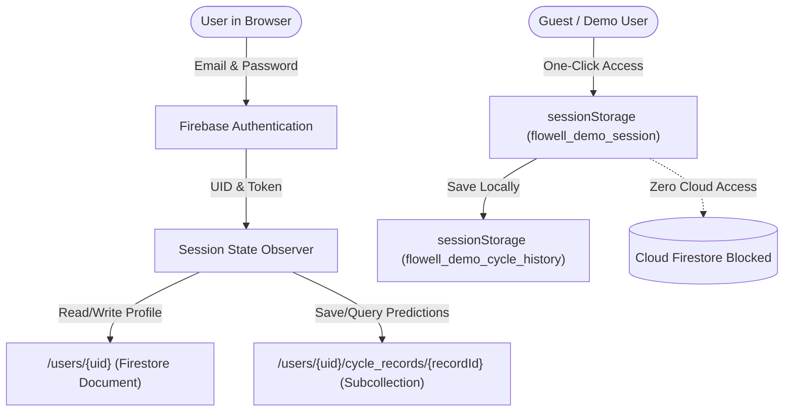

# FloWell | Your Period Partner

A compassionate, privacy-focused menstrual wellness companion and predictive cycle-tracking web application built with **HTML5, CSS3, modern Vanilla JavaScript (ES6+), Firebase Authentication, and Cloud Firestore**.

---

## 🌸 Overview

**FloWell** is designed to provide an accessible, lightweight, and comforting digital space for menstrual health tracking, holistic wellness education, and self-care guidance. 

FloWell combines a responsive, glassmorphic user interface styled in a sophisticated **Baby Pink & Deep Plum** aesthetic with cloud-backed user privacy. Each registered user receives an isolated, secure Cloud Firestore space for their profile and menstrual records, while a zero-friction **One-Click Demo Mode** allows instant evaluation completely isolated in local session storage without cloud reads or writes.

---

## ✨ Key Features

### 1. 🩸 Predictive Period Tracker & Health Analytics
- **Mathematical Estimation Engine:** Calculates predicted upcoming cycle dates using calendar date arithmetic based on the user's last period date and average cycle length.
- **Estimated Ovulation Windows:** Computes estimated fertile and ovulation windows ($14\text{ days}$ prior to the predicted next period).
- **Countdown & Cycle Status:** Dynamically displays active day countdowns relative to today (`⏳ Approximately X days remaining...`, `🌸 Today is your estimated cycle start day.`, etc.).
- **Input Validation & Sanity Constraints:** Strictly validates date inputs in `YYYY-MM-DD` format and validates realistic menstrual cycle lengths between 15 and 60 days.
- **Explicit Medical Disclaimer:** Every prediction is clearly labeled as a mathematical estimate rather than a clinical medical certainty.

### 2. ☁️ User-Specific Cloud Firestore Cycle History
- **Document Architecture:** Each authenticated user stores cycle predictions in their own Firestore subcollection:
  ```
  /users/{uid}/cycle_records/{recordId}
  ```
- **Strict Data Isolation:** Built on user-specific Firestore security rules (`request.auth.uid == userId`). Users can never read, modify, or delete another user's cycle records.
- **Latest 10 Chronological Records:** Queries the latest 10 predictions, newest first, displaying formatted prediction dates, ovulation estimates, and timestamp badges.
- **Safe, Confirmed Deletion:** The *Clear History* feature requires explicit confirmation via `confirm()` and deletes only the active user's cloud records with graceful partial-failure handling.
- **No Unsafe Automatic Migration:** Legacy shared browser records are preserved untouched in local storage and never co-mingled with an authenticated user's private cloud history.

### 3. 🔐 Firebase Authentication & Cloud Profiles
- **Modular Firebase Web SDK (v10):** Integrated natively via browser ES Modules from Google's CDN without requiring Node.js build tools, Webpack, or Vite.
- **Email & Password Authentication:** Real email/password registration and login with error mapping (`auth/email-already-in-use`, `auth/invalid-credential`, `auth/weak-password`).
- **Cloud Profiles (`/users/{uid}`):** Stores user display name, email, chosen emoji avatar, default cycle length, and account creation timestamp.
- **Self-Healing Profile Architecture:** Automatically verifies that parent profile documents exist upon login or session recovery, preventing orphaned subcollections.
- **Zero Plaintext Credentials:** No passwords, password hashes, or auth tokens are ever written to Firestore or application-managed local storage.

### 4. 🖥️ Isolated One-Click Demo Mode
- **Zero-Friction Evaluation:** Allows interviewers, evaluators, and guest users to experience FloWell with a single click.
- **Complete Cloud Isolation:** Demo mode operates strictly within browser `sessionStorage`. Demo users receive no Firebase UID, generate zero network calls to Firestore, and cannot view or alter real user records.
- **Distinct Visual Badges:** Records created in demo mode are explicitly labeled with `🖥️ Demo Session (Local)`.

### 5. 🤖 Mira: Rule-Based Menstrual Wellness Buddy
- **Empathetic Wellness Guidance:** An interactive wellness companion designed to answer questions regarding period cramps, nutrition, exercise safety, PMS mood shifts, hygiene, and normal cycle variations.
- **Deterministic Pattern Matching:** Mira operates on an **expert rule-based intent matching system** (not generative AI or LLMs), ensuring dependable, safe, and vetted responses.
- **Clinical Emergency Triage:** Contains built-in clinical red-flag triggers that instantly advise emergency medical care for signs of hemorrhage (e.g., soaking through multiple pads per hour with dizziness) or Toxic Shock Syndrome (TSS).
- **Typo Tolerance & Normalization:** Normalizes user queries to recognize common misspellings (e.g., `"crampps"`, `"exersise"`, `"peirod"`).
- **Quick-Question Chips:** One-click prompt chips allow users to quickly ask popular questions without typing.
- **Comprehensive Medical Disclaimer:** Features an omnipresent reminder that Mira is an educational buddy, not a medical professional.

### 6. 🌿 Comprehensive Menstrual Wellness Hub
A clean multi-page educational resource divided into focused guides:
- **📋 Do’s & Don’ts (`dos-donts.html`):** 28+ practical, evidence-based habits covering menstrual hygiene, heat therapy, sleep routines, stress management, hydration, and medical warning signs.
- **🧘‍♀️ Exercise & Movement (`exercises.html`):** 13+ movement cards across 4 filtered categories (*Stretching, Yoga, Low-Impact, Relaxation*) with step-by-step guidance, comfort tips, and gentle modifications.
- **🥗 Nutrition & Nourishment (`nutrition.html`):** 16+ nutrient-dense food cards across 6 categories (*Iron-Rich, Protein, Fruits & Veggies, Calcium/Magnesium, Hydration, Balanced Meals*) featuring accessible Indian comfort foods (such as *Moong & Toor Dal, Rajma, Palak & Methi, Chaas, Paneer, and Khichdi*), nutrient badges, and serving ideas.
- **💬 Dedicated Mira Chat Page (`mira.html`):** Full-screen chat interface with scrollable message history, auto-scrolling, keyboard enter-key support, and quick prompt chips.

### 7. 🎨 Aesthetic Glassmorphism Design System
- **Professional Palette:** Built with Baby Pink (`#F6DCE5`), Deep Plum (`#49354F`), Ivory (`#FFFAFC`), and Dusty Rose (`#C78FA5`).
- **Typography:** Google Fonts **Playfair Display** for brand headers paired with modern system sans-serif typography for maximum readability.
- **Ambient Animated Background:** 5 large, translucent organic floating orbs drifting across a slowly shifting gradient (12–22s cycles).
- **Accessibility & Reduced Motion:** Respects user operating system accessibility settings via `@media (prefers-reduced-motion: reduce)`.
- **Personalized Emoji Avatars:** Select from 8 curated avatars (🌸, 🦋, 🌷, 🐰, 🌙, 🎀, 🧸, ✨) saved to Cloud Firestore and displayed in the top navigation badge.

---

## 🛠️ Technology Stack

| Layer | Technology | Description |
|---|---|---|
| **Frontend Markup** | **HTML5** | Semantic, multi-page structure with accessible ARIA tags and responsive meta viewports. |
| **Styling & Design** | **CSS3** | CSS Variables, Flexbox, CSS Grid, Glassmorphic blurs (`backdrop-filter`), and keyframe animations. |
| **Frontend Logic** | **Vanilla JavaScript (ES6+)** | Native ES Modules, date arithmetic, intent matching, DOM event listeners, and session state guards. |
| **Authentication** | **Firebase Auth** | Client-side Email/Password authentication with `onAuthStateChanged` persistence. |
| **Database** | **Cloud Firestore** | Scalable NoSQL cloud database providing user-scoped documents and subcollections. |
| **Local Development** | **Node.js** | Lightweight static HTTP server (`server.js`) for local testing. |
| **Automated Testing** | **Node.js Test Runner** | Custom 36-scenario test runner (`verify_tests.js`) verifying auth, Firestore schema, permissions, math, and UI regression. |

---

## 🏛️ Cloud Architecture & Security Model



### Firestore Document Structure
```text
users/
└── {uid}/
    ├── name: "Vedanshi"
    ├── email: "user@flowell.com"
    ├── avatar: "🦋"
    ├── cycleLength: 28
    ├── createdAt: "2026-11-17T10:00:00.000Z"
    │
    └── cycle_records/
        └── {recordId}/
            ├── lastPeriod: "2025-10-10"
            ├── cycleLength: 28
            ├── nextPeriod: "2025-11-07"
            ├── ovulation: "2025-10-24"
            ├── isEstimate: true
            ├── nextPeriodFormatted: "7 Nov 2025"
            ├── ovulationFormatted: "24 Oct 2025 (Estimated)"
            └── createdAt: Timestamp
```

### Firestore Security Rule Principles
- `/users/{userId}`: Can only be read or written by `request.auth.uid == userId`.
- `/users/{userId}/cycle_records/{recordId}`: Can only be read or written by `request.auth.uid == userId`.
- Unauthenticated users and cross-user attempts are rejected with `HTTP 403 Forbidden` (`permission-denied`).

---

## 🚀 Local Setup & Installation

FloWell requires **zero build tools, zero bundlers, and zero package installations**. It runs directly in any modern web browser.

### Prerequisites
- [Node.js](https://nodejs.org/) (optional, for local development server) or Python 3.

### 1. Clone the Repository
```bash
git clone https://github.com/<your-username>/flowell.git
cd flowell
```

### 2. Start the Local Server

#### Option A: Using Node.js (Recommended)
```bash
node server.js
```

#### Option B: Using Python
```bash
python -m http.server 3000
```

### 3. Open in Browser
Navigate to:
- **Login / Register Page:** [http://localhost:3000/login.html](http://localhost:3000/login.html)
- **Dashboard / Tracker:** [http://localhost:3000/index.html](http://localhost:3000/index.html)

*(Alternatively, because FloWell uses browser-compatible native ES Modules and public Google CDN imports for Firebase, files can also be opened via Live Server in VS Code).*

---

## 🧪 Automated Verification Test Suite

FloWell includes a dedicated automated test suite (`verify_tests.js`) that validates all features, security rules, calculations, and UI regressions:

```bash
node verify_tests.js
```

### Test Coverage (36 Passed Tests):
1. **Firebase Authentication (Tests 1–5):** Registration, valid login, invalid credentials rejection, duplicate email blocking, and sign out state clearance.
2. **Session & Route Guards (Tests 6–7):** Session persistence across browser reloads via `onAuthStateChanged`, and route guards across all 5 protected pages.
3. **Firestore Profiles & Security (Tests 8–10):** Cloud profile loading, avatar synchronization, cross-user document access rejection, and demo mode isolation.
4. **Cycle History Cloud Subcollections (Tests 11–14):** Record saving, schema validation (`lastPeriod`, `cycleLength`, `nextPeriod`, `ovulation`, `createdAt`), browser refresh persistence, and re-login retrieval.
5. **Multi-User Isolation & Scoped Deletion (Tests 15–17):** Verified User 2 cannot see User 1's records; verified User 2 clearing history leaves User 1's records intact.
6. **Demo Mode Cloud Shield (Test 18):** Verified demo mode records save to `sessionStorage` with exactly 0 calls to Firestore.
7. **Input Validation & Deletion Confirmation (Test 19):** Rejected cycle length $< 15$ and malformed dates; confirmed cancellation aborts deletion.
8. **Privacy Audit (Test 20):** Confirmed zero passwords, auth tokens, or menstrual record payloads are logged to the console.
9. **Missing Profile Self-Healing (Tests 21–24):** Verified safe creation of missing parent documents, safe avatar upserts via `{ merge: true }`, preservation of custom user settings, and visible UI permission error reporting.
10. **Regression Suite (Tests 25–36):** Period prediction math ($10\text{ Oct} + 28\text{ days} = 7\text{ Nov}$), Playfair Display branding, official color palette, 5 animated floating orbs, footer attribution, navigation structure, 14 Do's & 14 Don'ts, 13 exercise cards, 16 food cards, dedicated Mira page, 10 distinct Mira questions, and emergency triage triggers.

---

## 📸 Screenshots

| View | Description |
|---|---|
| **Login & Registration** | Glassmorphic authentication card with avatar picker and one-click demo access. |
| **Tracker & Dashboard** | Clean Playfair Display header, period start date input, cycle length selector, and calculation card. |
| **Cloud Cycle History** | Chronological record listing with `☁️ FloWell Cloud Record` badges and ovulation estimates. |
| **Chat with Mira** | Full-screen interactive wellness buddy with quick-question chips and medical disclaimers. |
| **Menstrual Wellness Hub** | Dedicated guides for Do's & Don'ts, Exercise & Movement, and Nutrition & Healthy Foods. |

*(To attach repository screenshots, capture screenshots of the views above, place them in an `assets/screenshots/` folder, and link them here).*

---

## 📂 Project Directory Structure

```text
flowell/
│
├── index.html              # Main dashboard (Period tracker, prediction results, cloud history, wellness hub)
├── login.html              # Authentication portal (Email/password login, registration, one-click demo mode)
├── dos-donts.html          # Wellness guide: 28+ evidence-based Do's and Don'ts
├── exercises.html          # Wellness guide: 13+ category-filtered exercises and yoga routines
├── nutrition.html          # Wellness guide: 16+ nutrient-rich foods across 6 categories
├── mira.html               # Dedicated full-screen conversational interface with Mira
│
├── styles.css              # Main design system: palette (#F6DCE5, #49354F, #FFFAFC, #C78FA5), orbs, layout
├── login.css               # Styling for glassmorphic authentication cards and alerts
│
├── app.js                  # Tracker prediction math, cycle history Firestore manager, and Mira chatbot logic
├── auth.js                 # Firebase auth observer, route guards, profile self-healing, demo session manager
├── firebase-config.js      # Official modular Firebase v10 initialization and service exports
│
├── server.js               # Lightweight local Node.js static web server (port 3000)
├── verify_tests.js         # Automated verification test suite (36 tests)
├── test_live_backend.js    # Live Firebase backend connectivity verification probe
│
├── .gitignore              # Git ignore rules for node_modules, logs, environments, and secrets
└── README.md               # Comprehensive project documentation
```

---

## ⚠️ Medical & Educational Disclaimer

> **IMPORTANT:** FloWell is an educational prototype and personal wellness companion designed for informational and self-care tracking purposes. All menstrual cycle, ovulation, and fertile window predictions are mathematical estimates based on average cycle lengths and are **not clinical certainties, medical diagnoses, or family-planning guarantees**. Menstrual health naturally varies due to sleep, stress, illness, and lifestyle.
>
> Mira is a **rule-based wellness educational assistant**, not a licensed medical professional, healthcare provider, or clinical diagnostic tool. Users experiencing severe pelvic pain, abnormally heavy bleeding (such as soaking through multiple sanitary products per hour), high fevers, or symptoms of Toxic Shock Syndrome should seek immediate medical evaluation from a licensed healthcare provider.

---

## 👩‍💻 Author & Attribution

**Developed with ♡ by Vedanshi**  
*FloWell — Your Period Partner*  
© 2026 FloWell. All rights reserved.
